<p align="center">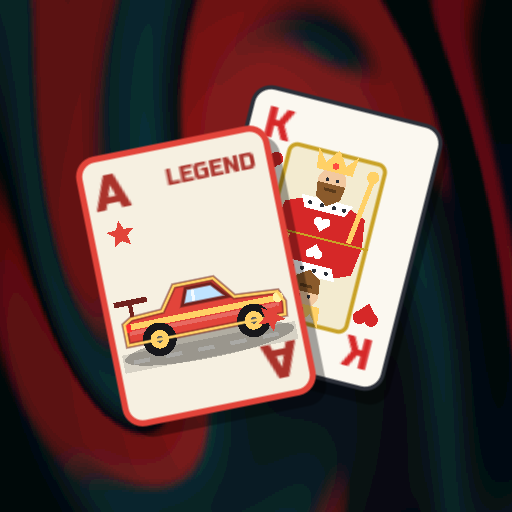</p>

# CARLATRO — Cars instead of cards.

A Balatro-like roguelike deckbuilder made in Godot 4.7, where every card is a car.

**Website and play in the browser: https://pycz2.github.io/carlatro/** (the game alone: [/play/](https://pycz2.github.io/carlatro/play/))

Made just for fun. The idea comes from the video [“Game Dev Has A Claude Problem” by Tim Ruswick (at 9:06)](https://www.youtube.com/watch?v=pJV_gqYCT1c&t=546s).

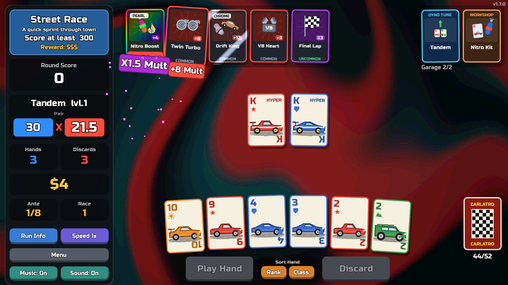

| | |
|---|---|
| 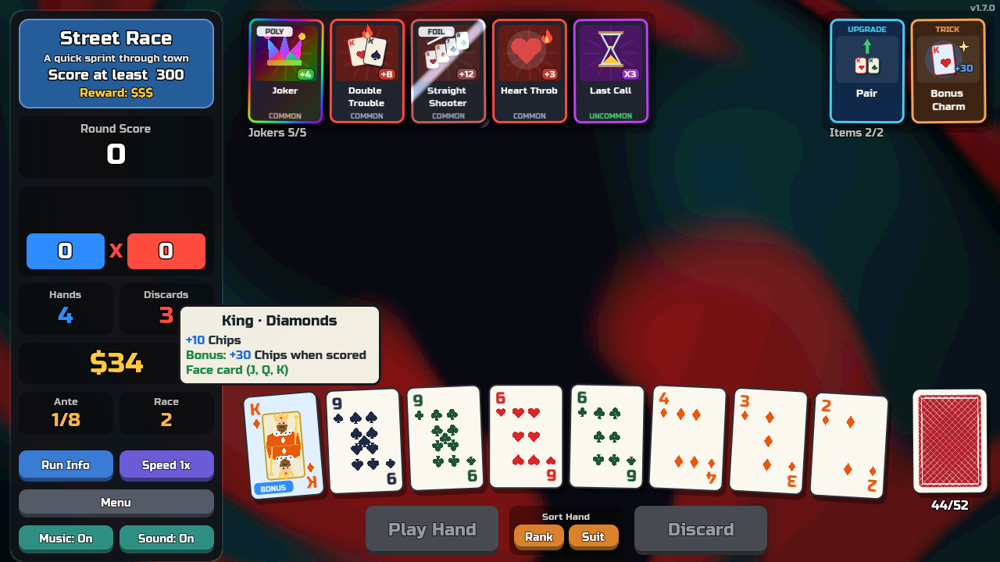 | 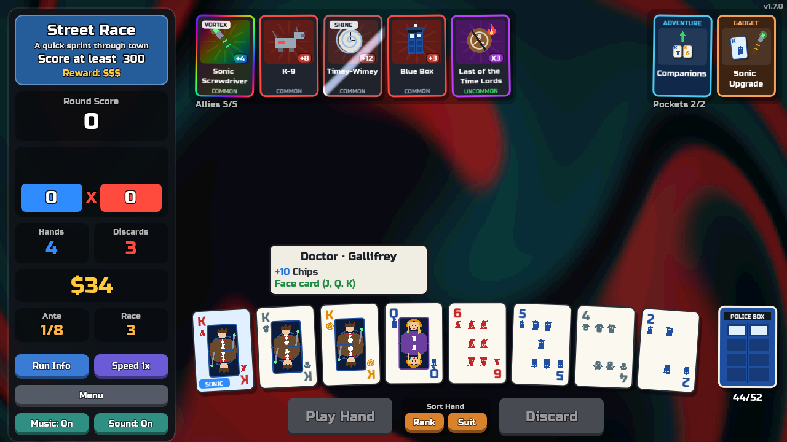 |
| 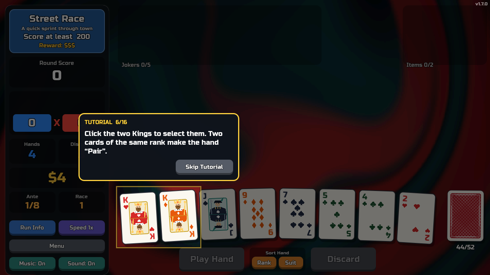 | 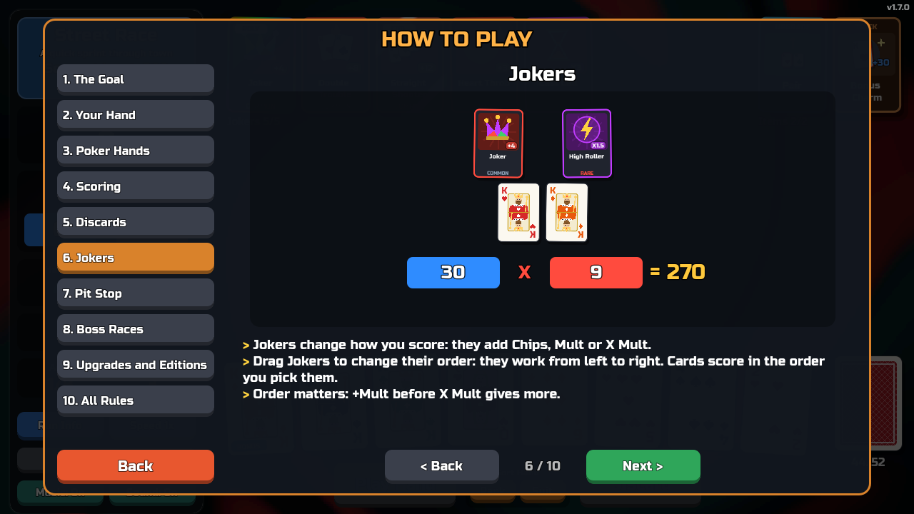 |
| 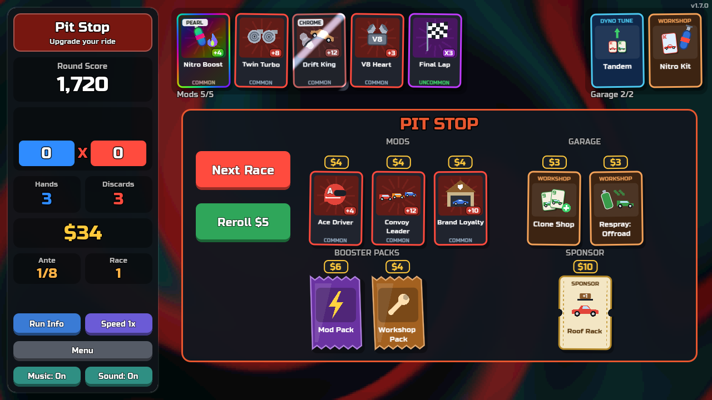 | 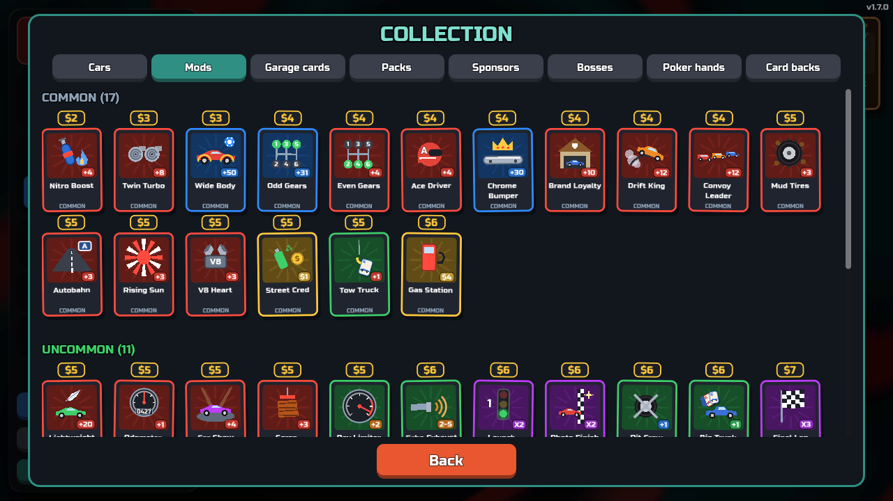 |
| 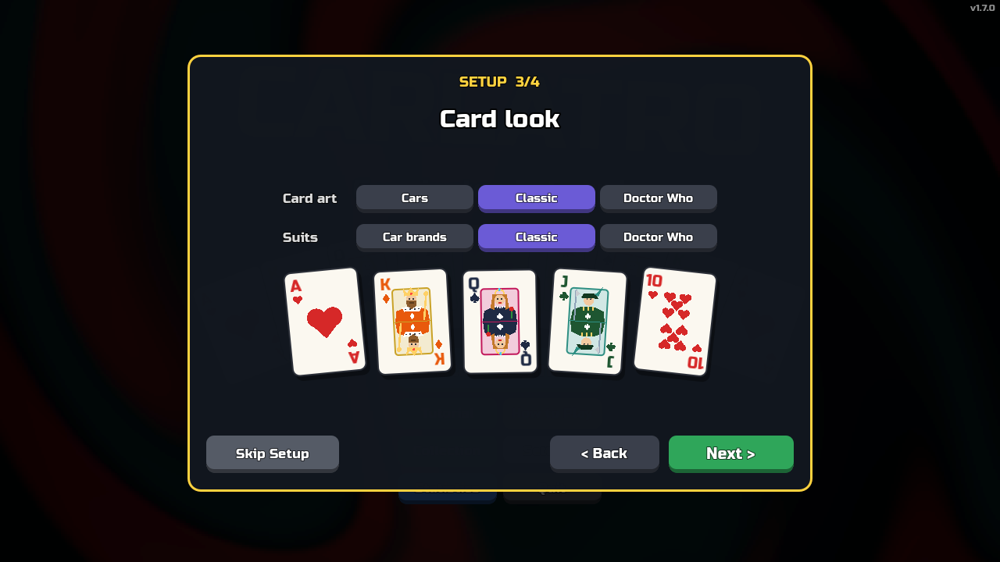 | 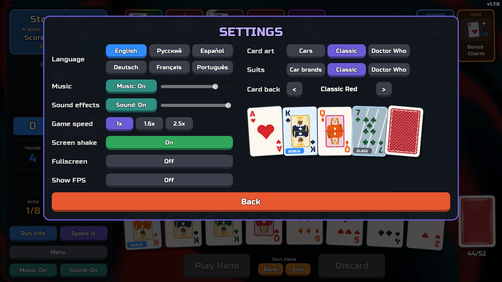 |
| 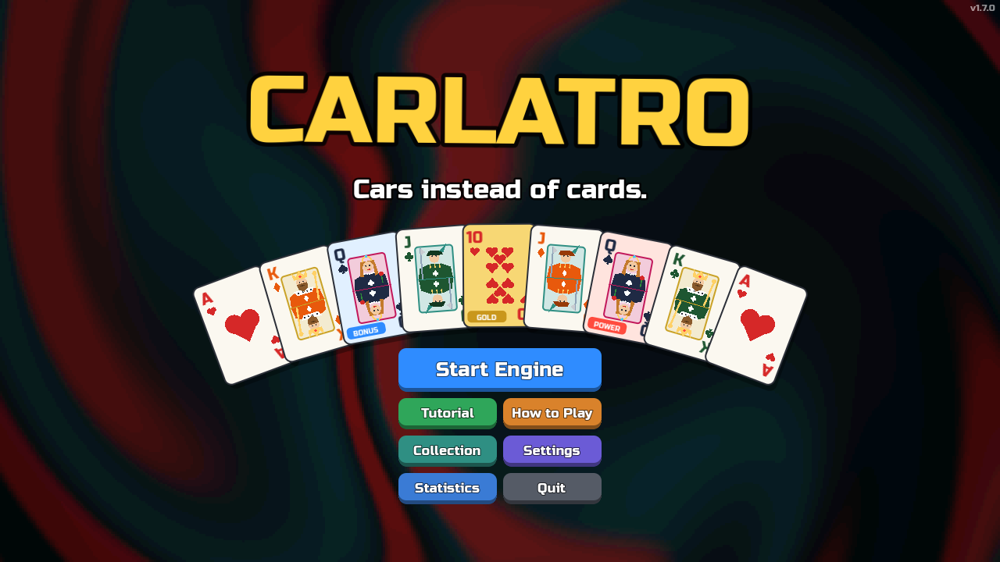 | 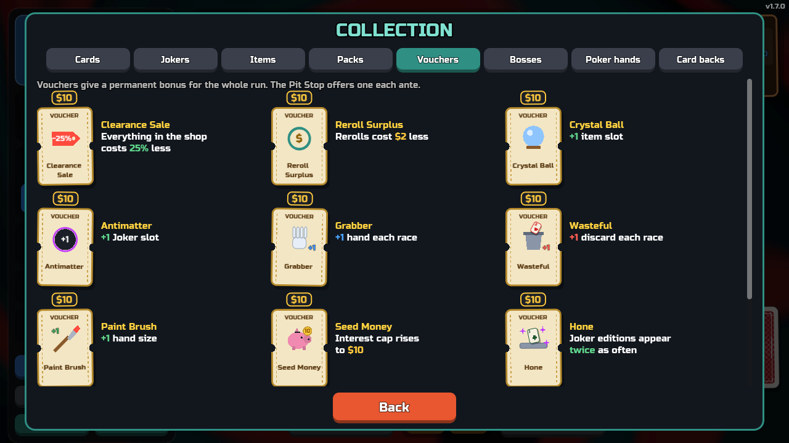 |

- 52 cars: 4 brands (Muscle, JDM, Euro, Offroad) × 13 ranks.
- Poker hands with car names: Tandem (Pair), Convoy (Three of a Kind), Gear Shift (Straight), Same Garage (Flush), Factory Line (Straight Flush)...
- 8 antes × 3 races (Street, Circuit, Boss with a nasty rule) → Grand Prix → endless mode.
- 30 Mods (jokers), Dyno Tunes (level up hands), Workshop cards (Nitro / Turbo / Carbon / Gold Rims, respray, clone, scrap...).
- Booster packs in the Pit Stop: Garage, Dyno, Workshop and Mod packs — open one, take 1 of the choices.
- Mod editions from the original game: Foil (+50 Chips), Holographic (+10 Mult), Polychrome (X1.5 Mult), Negative (+1 slot).
- Sponsors (car theme) / Vouchers (classic theme): permanent bonuses for the run, one offer per ante in the Pit Stop.
- Unique pictures for every mod, item, voucher and boss, drawn for the chosen card art (cars or playing cards);
  Collection encyclopedia; statistics with reset; changelog (click the version).
- Installable web app (PWA): add it to the home screen on Android, iPhone or a computer; full screen, landscape,
  works offline after the first start. Touch works like the mouse (tap, drag mods); portrait asks to rotate.
- First launch: a short setup (language, music and sound, card look, card back) that you can skip, then an offer to play the tutorial.
- Interactive tutorial (main menu → Tutorial): a guided first race with pop-up hints that point at the table; it never touches your saved run or statistics.
- How to Play: 10 steps with animated pictures (goal, hand, poker hands, scoring, discards, mods, Pit Stop, bosses, upgrades) and a full rules page.
- Autosave: quit any time (Menu → Main Menu, or close the game) and press Continue on the title screen.
- Settings (persist between launches): language, music on/off and volume, sound volume, game speed, screen shake, fullscreen,
  card art (Classic playing cards by default, Cars or Doctor Who), suits (car brands, Hearts/Diamonds/Spades/Clubs or
  TARDIS/Daleks/Cybermen/Gallifrey) and 8 card backs.
  The card vocabulary follows the art: classic cards use "cards", Jack/Queen/King, Bonus/Power/Glass/Gold, Jokers, Upgrades, Tricks;
  the Doctor Who theme uses Companion/Time Lady/Doctor, Allies, Adventures, Gadgets and Favours.
- Languages: English, Русский, Español, Deutsch, Français, Português (auto-detected from the system).
- The Doctor Who theme is an unofficial fan tribute. Doctor Who, TARDIS and Daleks are trademarks of the BBC; this project is not affiliated with the BBC.
- No external assets except the Russo One font (OFL). Card art, music, sounds and background are generated in code.

## Run on Mac

```sh
/Applications/Godot.app/Contents/MacOS/Godot --path .
```

Or open the folder in the Godot editor and press F5.

## Build

```sh
G=/Applications/Godot.app/Contents/MacOS/Godot
mkdir -p build/web build/mac
$G --headless --path . --export-release "Web" build/web/index.html
$G --headless --path . --export-release "macOS" build/mac/Carlatro.zip
```

Play the web build locally (a browser cannot open it from `file://`):

```sh
python3 -m http.server 8000 -d build/web   # then open http://localhost:8000
```

The web build is single-threaded, so any static hosting works (itch.io, GitHub Pages).

Release and publish to GitHub Pages: `./deploy_web.sh [patch|minor|major]`.
The website is the landing page in `site/` (at the root) with the web build in `/play/`.
The script needs a clean working tree and an entry for the new version in `scripts/changelog.gd`. It bumps `config/version` in `project.godot` (shown in the top-right
corner of the game), commits and tags `vX.Y.Z`, pushes, and publishes the web build to the `gh-pages` branch.

## Controls

Click cars to select up to 5. **Enter** plays the hand, **Backspace** discards, **Esc** opens the menu, **M** toggles music, **F11** (or ⌘⌃F) toggles fullscreen. Hover any card for details.
Click a Mod or a Garage card to sell or use it. Click the deck to see your whole garage.

## Code

| File | What |
|---|---|
| `scripts/game.gd` | UI and game flow (title → race select → race → cash out → pit stop) |
| `scripts/scoring.gd` | Hand evaluation and scoring rules |
| `scripts/data.gd` | Hands, mods, workshop cards, bosses |
| `scripts/card_view.gd` | Card node: drawing cars, mods and animations |
| `scripts/sfx.gd` | Synthesized sound effects |
| `scripts/music.gd` | Procedural synthwave music loop |
| `scripts/art.gd` | Pictures of mods, items, bosses, suit emblems, mini cards |
| `scripts/edition.gdshader` | Foil / Holographic / Polychrome / Negative looks |
| `scripts/changelog.gd` | Release notes shown in the game |
| `scripts/bg.gdshader` | Swirling background |
| `i18n/` | Translations (`strings.csv` is imported by Godot) |
| `site/` | Landing page of the website (cards rendered by `tools/site_cards.gd`) |
| `docs/screenshots/` | Screenshots for this README and the website (`tools/readme_shots.gd`) |
| `icons/` | The one app icon: window, macOS app, loading screen, PWA, website (`tools/app_icons.gd`) |

Save files: `~/Library/Application Support/Godot/app_userdata/Carlatro/` (`run.save`, `settings.cfg`).

Tests: `$G --headless --path . -s res://tests/test_scoring.gd`

Change texts: edit the code, run `python3 i18n/extract.py`, update `i18n/<locale>.json`, run `python3 i18n/build_csv.py`.
